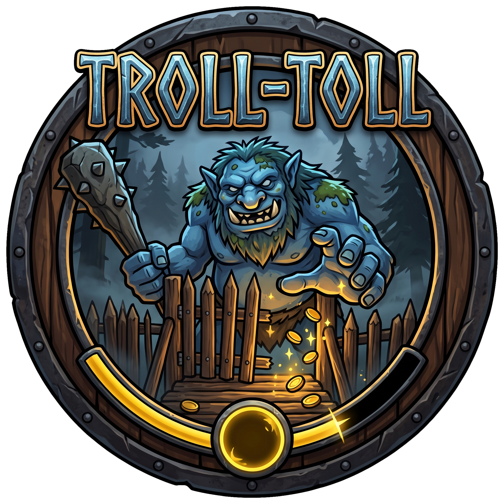

<p align="center">
  
</p>

# Troll-Toll

[](https://github.com/BeardyMike/Troll-Toll)
[](https://valheim.com)
[](https://github.com/BepInEx/BepInEx)

> *"You gotta pay the Troll-Toll... unless there are no trolls around!"*

A lightweight, high-performance Valheim mod that turns off stamina drain when exploring, building, or farming out of combat, while preserving full combat challenge. 

Featuring **granular creature control**, **biome-by-biome configuration**, and a progressive **Boss Relief system** where conquering biomes rewards you with permanent combat stamina discounts (culminating in 100% free stamina in conquered early biomes!).

---

## 🌟 Key Features

- **Contextual Stamina Costs**: Sprint, jump, dodge, sneak, and hammer-build with **zero stamina cost** when exploring or relaxing in your base.
- **Accurate Threat Detection**: Leverages Valheim's internal `BaseAI.IsEnemy` logic. Correctly ignores tamed pets (wolves, boars, lox) and friendly Dvergr, but detects hostile creatures, bosses, and raid attackers.
- **Boss Relief System**: Defeating a biome's boss unlocks permanent combat stamina relief (25% – 75%) for that biome. Each subsequent boss defeated beyond that biome grants further relief (+25% by default), culminating in **100% free stamina even during combat** in conquered biomes (e.g., after 4 bosses, the Meadows has 100% stamina relief)!
- **Granular Biome Control**: Toggle Troll-Toll individually for each biome (Meadows, Black Forest, Swamp, Mountain, Plains, Mistlands, Ashlands, Deep North, Ocean) and set per-biome detection radii.
- **Granular Creature Control**:
  - **Ignored Creatures List**: Comma-separated list of creature names or prefabs that will *never* trigger threat (e.g. `Greyling, Neck, Boar, Skeleton`).
  - **Enforced Threat List**: Comma-separated list of creatures that *always* trigger threat (e.g. `Troll, Abomination, Gjall`).
  - **Per-Creature Detection Radii**: Set custom threat ranges per creature (e.g. `Troll:50, Abomination:40, Greyling:10`).
  - **Quick Toggles**: Fast boolean toggles to ignore wild Boars, Necks, Greylings, Bats, and Skeletons.
- **Zero-Stamina Protection**: Patches `Player.HaveStamina` so you aren't blocked from sprinting, jumping, or building when actions are discounted.
- **Raid Awareness**: Automatically enforces normal stamina consumption whenever a base raid or random event is active.
- **In-Game Chat Command**: Type `/trolltoll` or `/tt` in chat to inspect your current biome, boss defeat status, active discount, and nearby threat state.
- **Multiplayer Friendly**: Client-side mod. Can be used on vanilla and modded servers without requiring server installation.
- **Lag-Free**: Threat scanning is cached (default every `0.2s`), eliminating micro-stutters even in massive, creature-dense bases.

---

## 👑 How the Boss Relief System Works

When you defeat the boss of a biome, you unlock **permanent combat stamina relief** for that biome:
1. **Initial Relief**: Defeating the biome's boss unlocks base relief (default `25%`, configurable between `25%` and `75%`).
2. **Additional Boss Scaling**: For each additional boss defeated in world progression, earlier conquered biomes gain stronger relief (default `+25%` per additional boss).
3. **Mastery Cap**: Caps at `100%` (zero stamina drain even while actively fighting).

### Example Progression Table (Default 25% Base + 25% Per Additional Boss):
| Bosses Defeated | Meadows | Black Forest | Swamp | Mountain | Plains | Mistlands | Ashlands |
|---|---|---|---|---|---|---|---|
| **Eikthyr** (Meadows) | **25%** | 0% | 0% | 0% | 0% | 0% | 0% |
| **The Elder** (Black Forest) | **50%** | **25%** | 0% | 0% | 0% | 0% | 0% |
| **Bonemass** (Swamp) | **75%** | **50%** | **25%** | 0% | 0% | 0% | 0% |
| **Moder** (Mountain) | **100%** | **75%** | **50%** | **25%** | 0% | 0% | 0% |
| **Yagluth** (Plains) | **100%** | **100%** | **75%** | **50%** | **25%** | 0% | 0% |
| **The Queen** (Mistlands) | **100%** | **100%** | **100%** | **75%** | **50%** | **25%** | 0% |
| **Fader** (Ashlands) | **100%** | **100%** | **100%** | **100%** | **75%** | **50%** | **25%** |

*(Notice: after 4 bosses total, Meadows reaches 100% stamina relief, making you the undisputed master of early lands!)*

---

## 💬 In-Game Chat Commands

Open chat (`Enter`) and type:
- `/trolltoll` *(or `/tt`)*: Prints your current biome, boss defeat status, total world bosses defeated, nearby threat detection status, and effective stamina discount percentage.

---

## ⚙️ Configuration

Configuration is automatically generated at `BepInEx/config/com.beardymike.trolltoll.cfg`. You can edit this file in any text editor or configure it via the **r2modman / Thunderstore Configuration Manager**.

### 1 - General
| Setting | Type | Default | Description |
|---|---|---|---|
| `Enabled` | `bool` | `true` | Master switch to enable or disable Troll-Toll. |
| `DetectionRadius` | `float` | `30.0` | Default global radius in meters to search for threats. Inside this radius, stamina costs apply normally unless discounted by Boss Relief. |

### 2 - Detection
| Setting | Type | Default | Description |
|---|---|---|---|
| `IncludePassiveCreatures` | `bool` | `false` | If true, non-hostile animals (deer, birds) also trigger stamina costs. |
| `RequireAlertedOnly` | `bool` | `false` | If true, nearby enemies only trigger stamina consumption once actively alerted or targeting someone. |
| `EnforceDuringRaids` | `bool` | `true` | Always enforce normal stamina consumption during active base raids / random events. |
| `EnableInPVP` | `bool` | `true` | Hostile players with PvP enabled within range trigger normal stamina costs. |

### 3 - Restrictions
| Setting | Type | Default | Description |
|---|---|---|---|
| `AllowSwimmingStaminaDiscount` | `bool` | `false` | If true, swimming out of combat costs zero stamina (keep false to preserve ocean drowning balance). |
| `AllowEncumberedStaminaDiscount` | `bool` | `false` | If true, encumbered walking out of combat costs zero stamina. |

### 4 - Performance
| Setting | Type | Default | Description |
|---|---|---|---|
| `UpdateInterval` | `float` | `0.2` | Seconds between nearby threat scans. Caching scans prevents frame rate drops. |

### 5 - Biome Controls
| Setting | Type | Default | Description |
|---|---|---|---|
| `[Biome]_Enabled` | `bool` | `true` | Toggle Troll-Toll individually for Meadows, Black Forest, Swamp, Mountain, Plains, Mistlands, Ashlands, Deep North, and Ocean. |
| `[Biome]_DetectionRadius` | `float` | `30.0` | Threat detection radius for this specific biome (set to `-1` to use global `DetectionRadius`). |

### 6 - Creature Controls
| Setting | Type | Default | Description |
|---|---|---|---|
| `IgnoredCreatures` | `string` | `Deer, Seagull, Crow` | Comma-separated list of creature names or prefabs that NEVER trigger threat (e.g. `Greyling, Neck, Boar, Skeleton`). |
| `EnforcedThreatCreatures` | `string` | `Troll, Abomination, StoneGolem, Gjall, SeekerSoldier` | Comma-separated list of creatures that ALWAYS trigger threat within radius, even if unalerted. |
| `CustomCreatureRadii` | `string` | `Troll:50, Abomination:40, Gjall:50` | Creature-specific detection radius in `Name:Distance` format. Overrides biome and global radius for that creature. |
| `BossesAlwaysThreat` | `bool` | `true` | If true, any active boss in detection range is always treated as an active threat. |
| `IgnoreBoars` | `bool` | `false` | Quick toggle: Wild Boars never trigger threat or interrupt free stamina. |
| `IgnoreNecks` | `bool` | `false` | Quick toggle: Necks never trigger threat or interrupt free stamina. |
| `IgnoreGreylings` | `bool` | `false` | Quick toggle: Greylings never trigger threat or interrupt free stamina. |
| `IgnoreBats` | `bool` | `false` | Quick toggle: Bats never trigger threat or interrupt free stamina. |
| `IgnoreSkeletons` | `bool` | `false` | Quick toggle: Skeletons never trigger threat or interrupt free stamina. |

### 7 - Boss Relief System
| Setting | Type | Default | Description |
|---|---|---|---|
| `BossReliefEnabled` | `bool` | `true` | Master switch for the Boss Relief system. |
| `BossReliefBasePercent` | `float` | `25.0` | Base stamina relief percent (slider 0–100%, recommended 25%–75%) granted in a biome immediately upon defeating its boss. |
| `BossReliefPerAdditionalBossPercent` | `float` | `25.0` | Additional stamina relief added for each subsequent boss defeated beyond that biome. |
| `BossReliefCapPercent` | `float` | `100.0` | Maximum stamina relief percentage attainable in any biome (100% = zero stamina drain even in combat). |
| `BossReliefCalculationMode` | `string` | `ProgressionTier` | `ProgressionTier`: higher-tier defeated bosses increase relief. `AllDefeatedBosses`: any other defeated boss in the world increases relief. |
| `OceanBossRelief` | `bool` | `true` | If true, Ocean receives stamina relief scaling with total world bosses defeated. |
| `ShowBiomeEntryMessage` | `bool` | `false` | Displays a brief top-left notification showing your current biome's Boss Relief stamina discount upon entering a new biome. |

---

## 📦 Installation

### Using a Mod Manager (Recommended)
1. Install [r2modman](https://valheim.thunderstore.io/package/ebkr/r2modman/) or the Thunderstore Mod Manager.
2. Search for **Troll-Toll** and click **Download with Mod Manager**.

### Manual Installation
1. Install [BepInExPack Valheim](https://valheim.thunderstore.io/package/denikson/BepInExPack_Valheim/).
2. Download the latest `TrollToll.dll` from the Releases page.
3. Place `TrollToll.dll` into your `Valheim/BepInEx/plugins/` folder.

---

## 🛠️ Building From Source

```powershell
dotnet build
```

The project targets `.NET Standard 2.1` for compatibility with Valheim's Unity runtime.

### Automatic Path Detection
The build automatically locates your Valheim and BepInEx assemblies using:
1. Standard Steam installation directories across common drive letters (`C:`, `D:`, `E:`).
2. Dynamic user profile paths (`$(APPDATA)`) for **r2modman** and **Thunderstore Mod Manager** profiles, so anyone can clone and build immediately without editing the project file.
3. System environment variables (`VALHEIM_INSTALL_DIR` or `VALHEIM_PATH`) if defined.

### Custom Installation Paths
If your game or BepInEx core is in a custom folder, copy `Environment.props.example` to `Environment.props` and uncomment your paths:

```xml
<Project>
  <PropertyGroup>
    <ValheimPath>D:\Games\Steam\steamapps\common\Valheim</ValheimPath>
    <BepInExCorePath>D:\Games\Steam\steamapps\common\Valheim\BepInEx\core</BepInExCorePath>
  </PropertyGroup>
</Project>
```
*(Note: `Environment.props` is ignored by Git, so your local machine paths will never be committed).*

---

## 📄 License & Credits

- **Author**: BeardyMike
- **Compatibility**: Valheim (Ashlands & Bog Witch updates) + BepInEx 5.4.x
- Licensed under the **MIT License**.
